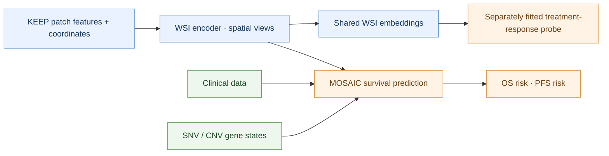

<a id="top"></a>

<div align="center">

# 🧩 MOSAIC

### Connecting histopathology, clinical information, and genomics
**Multimodal survival prediction · Shared WSI representations · Reproducible examples**

[](https://huggingface.co/Astaxanthin/MOSAIC)
[](https://drive.google.com/drive/folders/1IUbXoDB1KSfdNoSZMUHderIqItNFMSA1?usp=drive_link)
[](notebooks)

[🚀 Quick start](#quick-start) &nbsp;·&nbsp; [🔬 Features](#representations) &nbsp;·&nbsp; [📦 Data](#download-example-data) &nbsp;·&nbsp; [🧪 Reproduction](#reproduce-the-example-tasks)

</div>

---

MOSAIC combines separately pretrained biomedical representations to predict **overall survival (OS)** and **progression-free survival (PFS)**. It supports clinical, genomic, and WSI inputs, including missing modalities, and exposes shared WSI embeddings for downstream prediction tasks.

<table>
<tr>
<td width="33%" valign="top">
<h3>🔬 Histopathology</h3>
Turn KEEP patch features into shared WSI embeddings for downstream prediction.
</td>
<td width="33%" valign="top">
<h3>🧬 Multimodal survival</h3>
Predict OS and PFS risk from available clinical, genomic, and pathology inputs.
</td>
<td width="33%" valign="top">
<h3>🧪 Reproducible examples</h3>
Run Yale HER2 treatment-response prediction and HCMI four-setting OS evaluation.
</td>
</tr>
</table>

<details>
<summary><b>🗺️ At a glance — inputs, representations, and outputs</b></summary>



Inputs may be supplied separately or combined. The treatment-response probe is trained separately from the survival model; shared WSI embeddings remain visual representations.

</details>

---

<a id="quick-start"></a>

## 🚀 Quick start

### 1. Install

Python 3.10 or newer is recommended. Install PyTorch for your CPU/CUDA environment, then:

```bash
git clone https://github.com/MAGIC-AI4Med/MOSAIC.git
cd MOSAIC
pip install -r requirements.txt
```

### 2. Load MOSAIC

```python
import h5py
import torch
from transformers import AutoModel

device = "cuda" if torch.cuda.is_available() else "cpu"
model = AutoModel.from_pretrained(
    "Astaxanthin/MOSAIC", trust_remote_code=True,
).to(device).eval()
```

A local model directory can replace the Hub ID. `Astaxanthin/KEEP` is the upstream patch encoder; **load `Astaxanthin/MOSAIC` for the calls below**. The MOSAIC tokenizer is bundled and loaded automatically.

### 3. Predict risks and extract a WSI embedding

```python
# Features and coordinates must describe the same patches in the same order.
with h5py.File("slide_features.h5", "r") as f:
    features = f["features"][:]  # [N, 768], KEEP patch features
    coords = f["coords"][:]      # [N, 2], integer spatial coordinates

output = model.predict(
    patch_features=features,
    patch_coords=coords,
    cancer_type="Lung Adenocarcinoma",
    clinical={"age": 65, "sex": "Male", "stage": "II"},
    genomics={"snv": ["TP53"], "cnv": ["CDKN2A"]},
)

print("WSI embedding:", output["wsi_features"].shape)  # [1, 768]
print("OS risk:", output["os_risk"].item())
print("PFS risk:", output["pfs_risk"].item())

```

<details>
<summary><b>🔀 More input combinations: clinical only, vision only, and clinical + genomics</b></summary>

```python
# Clinical only: no WSI or genomics required.
clinical_only = model.predict(
    cancer_type="Lung Adenocarcinoma",
    clinical={"age": 65, "sex": "Male", "stage": "II"},
)

# Vision only: omit all text inputs, including cancer_type.
vision_only = model.predict(patch_features=features, patch_coords=coords)

# Clinical + genomics: leave CNV unknown when only SNV was evaluated.
clinical_genomics = model.predict(
    cancer_type="Lung Adenocarcinoma",
    clinical={"age": 65, "sex": "Male", "stage": "II"},
    genomics={"snv": ["TP53"], "cnv": -1},
)
```

</details>

<a id="representations"></a>

## 🔬 Which representation should I use?

| Representation | Shape / location | Purpose |
|---|---|---|
| **Patch features** | Input `patch_features`, `[N, 768]` | Local histopathology representations extracted with KEEP. These are the input to the WSI aggregator, not patient-level predictions. |
| **Shared WSI embedding** | `wsi_features`, `[1, 768]` | A slide-level representation before endpoint-specific adaptors. Use it as input to a downstream classifier, such as the Yale HER2 treatment-response probe below. Other tasks require their own labels, training and validation. |
| **Per-view WSI embeddings** | `view_wsi_features`, `[V, 768]` | Spatial-view representations for inspecting or reproducing slide-level feature aggregation. |
| **OS / PFS risk** | `os_risk`, `pfs_risk` | Endpoint-specific predictions from the available modalities. Use for survival discrimination, e.g. C-index; higher values indicate greater predicted risk. |
| **Per-view risks** | `view_os_risk`, `view_pfs_risk`, `[V]` | Endpoint-specific predictions before independent max pooling over views. |

> [!NOTE]
> The shared WSI embedding is a **visual representation**, even when clinical/genomic inputs are supplied. It is not a fused multimodal embedding. The language representations and endpoint-specific adapted features are used internally and are not separate outputs of the basic API.

**Treatment response and survival use different prediction paths:** the treatment example trains a logistic-regression probe on WSI embeddings; it does not treat the OS/PFS risk scores as treatment-response probabilities. No treatment-response classifier is bundled in the survival checkpoint.

<details>
<summary><b>⚙️ Spatial views, patient aggregation, and view batching</b></summary>

`predict` handles spatial padding and deterministic coverage with 80 × 80 patch-grid views. It independently takes the maximum OS and PFS risk across views. The shared WSI embedding is pooled by an elementwise maximum; survival risks are not recomputed from that pooled embedding. Use `predict_view` only for an already prepared view.

Multiple slides are **not** combined automatically. These examples reproduce the original patient aggregation:

- **Treatment:** max over view embeddings → mean over slide embeddings → L2 normalization → linear probe.
- **Survival:** max over view risks → mean over slide risks → patient-level C-index.

For treatment reproduction, view batching also matters. The original evaluator batches up to **8 views**; the public `predict` loop evaluates views individually. Nyström attention's approximate inverse includes batch-wide normalization, so changing this can change embeddings. The Yale script uses the **HF-loaded backbone with the original view batching** by default. The HCMI script uses `predict` with the validated survival settings.

</details>

<a id="input-conventions"></a>

## 🧬 Input conventions

- Extract patch features with the same KEEP encoder and preprocessing used for training. A matching feature dimension alone does not make another encoder interchangeable.
- Supply matching integer `(x, y)` coordinates in the feature-extraction coordinate system, not arbitrary patch indices.
- Clinical keys: `age`, `sex`, `stage`, `grade`, `subtype`. Aliases `diagnosis age`, `gender`, and `tumor stage` are accepted; `cancer_type` is supplied separately.
- Genomic `snv` / `cnv` values are lists of qualifying gene names, not raw variants or numeric copy-number values. For a panel, filter the observed list to that panel first.
- Omitted genomic fields, `None`, or `-1` mean **unknown**. `[]` means **known absence of qualifying alterations in the evaluated gene set**. Do not replace missing measurements with empty lists.
- Each call handles one slide/patient input. Outputs are CPU tensors. Without WSI, `wsi_features` is `None`, and per-view outputs are absent.

<a id="reproduce-the-example-tasks"></a>

## 🧪 Reproduce the example tasks

Use either the **interactive terminal scripts** or the **step-by-step notebooks**:

| Task | Python script | Notebook |
|---|---|---|
| 💊 Yale HER2 treatment response | [reproduce_yale_her2.py](examples/reproduce_yale_her2.py) | [Yale HER2 walkthrough](notebooks/01_yale_her2_treatment.ipynb) |
| 📈 HCMI four-setting OS | [reproduce_hcmi_os.py](examples/reproduce_hcmi_os.py) | [HCMI walkthrough](notebooks/02_hcmi_os.ipynb) |

Running a script without arguments in a terminal prompts for paths and settings. Press Enter to retain defaults. All paths are configurable; no workstation-specific paths are hard-coded. Model weights are hosted on [Hugging Face](https://huggingface.co/Astaxanthin/MOSAIC). Download the example patch features and metadata from [Google Drive](https://drive.google.com/drive/folders/1IUbXoDB1KSfdNoSZMUHderIqItNFMSA1?usp=drive_link); these data files are not included when cloning this code repository.

<a id="download-example-data"></a>

### 📦 Download example data

**[⬇️ Open the MOSAIC example data folder on Google Drive](https://drive.google.com/drive/folders/1IUbXoDB1KSfdNoSZMUHderIqItNFMSA1?usp=drive_link)**

Download the two feature folders and their corresponding metadata JSON files:

| Task | Feature folder | Metadata file |
|---|---|---|
| HCMI OS | [`example_hcmi_feats/`](https://drive.google.com/drive/folders/1-8nydCaU-2qJdP3hLFM1GXUt2G3w_EZ-) | `hcmi_dataset.json` from the [shared folder](https://drive.google.com/drive/folders/1IUbXoDB1KSfdNoSZMUHderIqItNFMSA1?usp=drive_link) |
| Yale HER2 treatment response | [`example_yale-her2_feats/`](https://drive.google.com/drive/folders/1LdLp6TbvtldLgoyjyM9oaKNPjm-1csNF) | `yale_her2_dataset.json` from the [shared folder](https://drive.google.com/drive/folders/1IUbXoDB1KSfdNoSZMUHderIqItNFMSA1?usp=drive_link) |

1. Download the required folders and JSON files from Drive. Folder downloads may be delivered as ZIP archives; extract them locally.
2. Place the extracted feature folders and both JSON files directly under `data/` in this repository. Keep the original `.h5` filenames and folder names. If the download contains an outer `MOSAIC_example_features/` directory, move its contents into `data/`.
3. Ensure the `.h5` files are directly inside each feature folder, without an extra nested copy of the same folder. If Drive creates multiple ZIP archives for one folder, extract and combine their contents into that folder.

The scripts match feature files using the slide IDs in the metadata. Extra feature files do not add patients to the evaluation. If you prefer another download location, set `--features` and `--metadata` (Yale) or `--data` (HCMI), or edit the notebook's configuration cell.

Default local layout:


```text
MOSAIC/
├── examples/
├── notebooks/
├── data/
│   ├── hcmi_dataset.json
│   ├── yale_her2_dataset.json
│   ├── example_hcmi_feats/
│   │   └── *.h5
│   └── example_yale-her2_feats/
│       └── *.h5
└── outputs/                     # Generated locally; ignored by Git
```

Check the downloaded inputs before loading the model:

```bash
python examples/reproduce_yale_her2.py --no-interactive --validate-only
python examples/reproduce_hcmi_os.py --no-interactive --validate-only
```

The Yale check should identify **85 patients (36 responders, 49 non-responders)** with the validated five-fold split. HCMI should identify **69 eligible slides from 35 patients**. The full HCMI evaluation contains **15 OS events**. These checks use local data and do not download model weights.

For notebooks:


```bash
pip install -r requirements-notebooks.txt
jupyter lab
```

<a id="yale-her2"></a>

### 💊 Yale HER2 — treatment-response prediction

```bash
python examples/reproduce_yale_her2.py
```

Noninteractive equivalent:

```bash
python examples/reproduce_yale_her2.py --no-interactive --features data/example_yale-her2_feats --metadata data/yale_her2_dataset.json --output outputs/yale_her2
```

The script checks the validated cohort of **85 patients (36 responders, 49 non-responders)**, sorts case IDs, and reproduces five-fold stratified cross-validation with seed 42. A cohort fingerprint prevents silently evaluating a different set of patients. StandardScaler and a balanced logistic-regression classifier are fitted using training folds only. Held-out probabilities use a 0.5 classification threshold.

Optionally pass `--reference path/to/original_predictions.json` to check saved folds and compare each patient's new and original prediction. The original all-dataset JSON and its extracted Yale result are both accepted. A reference file is not required to reproduce the deterministic split.

<details>
<summary><b>📊 Verified results and comparison with the original evaluation</b></summary>

| Metric | Original evaluation | Verified HF reproduction* |
|---|---:|---:|
| Mean five-fold AUROC | 0.761587 | 0.761587 |
| Fold AUROC standard deviation | 0.124025 | 0.124025 |
| Mean balanced accuracy | 0.674921 | 0.674921 |
| Mean accuracy | 0.682353 | 0.682353 |
| Pooled out-of-fold AUROC | 0.755669 | 0.755102 |

*All five individual-fold metrics and all 85 predicted classes matched. Probabilities were not bitwise identical; the mean absolute difference was 0.001545. Pooled OOF AUROC uses comparisons across folds and is distinct from mean fold AUROC. Runtime versions and view batching can affect reproduction; the script records configuration and model fingerprints.*

</details>

Outputs include `frozen_folds.csv`, `patient_embeddings.npz`, `oof_predictions.csv`, `fold_metrics.csv`, `metrics.json`, and a resumable slide-embedding cache.

<a id="hcmi-os"></a>

### 📈 HCMI — OS with four input settings

```bash
python examples/reproduce_hcmi_os.py
```

Noninteractive equivalent:

```bash
python examples/reproduce_hcmi_os.py --no-interactive --features data/example_hcmi_feats --data data/hcmi_dataset.json --bootstrap 1000 --output outputs/hcmi_os
```

All settings use the same feature-available, OS-valid test patients. The genomic input is **TP53 SNV only**; CNV remains unknown (`-1`). These are continuous-risk predictions: no gene-direction weights or high/low-risk grouping enters the risk or C-index computation.

| Setting | Inputs | Verified OS C-index |
|---|---|---:|
| C | Clinical | 0.675214 |
| C + P | Clinical + pathology | 0.700855 |
| C + G | Clinical + TP53 SNV | 0.689459 |
| C + P + G | All three | 0.723647 |

The verified cohort contains **35 patients, 69 slides and 15 OS events**. The script saves patient and slide risks, Harrell C-index, percentile 95% CIs from 1,000 paired patient-level bootstrap samples, and differences from clinical-only performance. These figures are reproduction checks on this cohort, not guarantees for other data.

Outputs include `patient_predictions.csv`, `slide_predictions.csv`, `metrics.csv`, `run_config.json`, and a resumable slide-risk cache. Excluded records and reasons are written when applicable.

<details>
<summary><b>🗂️ Metadata schema and label conventions</b></summary>

Metadata JSON is keyed by slide ID. Each slide maps to `<slide stem>.h5`, containing `features` and `coords`. The following entries are **schema examples**, not real patient records:

```json
{
  "example_slide.svs": {
    "case_id": "example_patient",
    "project": "pancan_hcmi_2025|Pancreatic_Cancer",
    "state": "test",
    "cancer type": "Pancreatic Cancer",
    "clinical": {"diagnosis age": 65, "gender": "Male", "tumor stage": "II"},
    "surv_prior": {"grade": "G2", "subtype": "Pancreatic Adenocarcinoma", "mutation": ["TP53"], "cnv": -1},
    "survival": {"os_state": 1, "os_time": 730}
  }
}
```

Yale metadata requires `case_id` and a treatment-response label. The evaluator reads top-level `treatment_response` / `raw_treatment_response`, then nested `task.treatment_response` / `surv_prior.treatment_response`. Recognized positive labels are `effective`, `responder`, `pcr`; negative labels are `invalid`, `nonresponder`, `rd`. **In this dataset convention, `invalid` means non-response, not a missing label.**

</details>

### ⚙️ Reproducibility options

- `--model /path/to/MOSAIC`: use local weights instead of the Hub.
- `--revision COMMIT_SHA`: pin a Hub snapshot for repeatable downloads.
- `--device cpu` or `--device cuda`: choose the inference device.
- `--validate-only`: check cohort/metadata (and Yale folds) without model inference.
- `--help`: list all arguments, including the Yale `predict` comparison mode.

Caches are reused only when their recorded model/input configuration matches. Use a new output directory after changing model, device or evaluation settings. For HCMI, `--limit` is a smoke-test option only; its metrics are explicitly marked as such.

<a id="scope"></a>

## 📚 Scope and acknowledgments

MOSAIC risk scores are relative predictions, not calibrated survival probabilities. WSI embeddings require a separately fitted and validated predictor for each downstream task. This release supports research reproduction and does not establish clinical utility.

We acknowledge [KEEP](https://huggingface.co/Astaxanthin/KEEP) for the patch representation and tokenizer/configuration assets. The KEEP image encoder is not bundled with the MOSAIC survival checkpoint.

<!-- Before publishing: add the paper citation, author/contact details and an
explicit project license. No license is inferred from dependency licenses. -->

<p align="center"><a href="#top">↑ Back to top</a></p>
